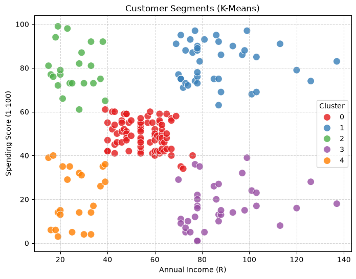

# **Blue-Mall Customer Segmentation**

A complete machine learning project that segments blue-mall customers into distinct behavioural groups using K-Means clustering based on their annual income and spending scores to facilitate the generation of actionable recommendations.

---

## 📌 **Project Charter: Blue-Mall customer segmentation**

**1. Project Metadata**
- **Project Title:** Tenant Portfolio Planning and Behavioural Segmentation Analysis
- **Sponsor:** Blue-Mall executive management (on behalf of all stakeholders)
- **Execution:** TMK Data Analytics Consulting
- **Methodology:** Unsupervised machine learning (K-Means clustering) utilising historical customer demographics and behavioural metrics
- **Project Duration:** 6 weeks

**2. Project Objectives**

Despite reliable visitor numbers, Blue-Mall underperforms in commercial yield, revenue per square metre, and in building lasting relationships with high-value tenants. We intend to build an empirical customer segmentation framework that aligns physical leasing strategies and marketing campaigns with the actual purchasing power and spending behaviour of mall visitors.

**Core Objectives**
1. Segment the visitor population into distinct clusters using Annual Income and Spending Scores via K-Means cluster analysis.
2. Provide asset managers with actionable guidance on which retail, dining, and service categories to recruit or relocate to capture high-value customer clusters.
3. Transition general promotional campaigns toward targeted micro-segmentation strategies designed to activate high-income, low-spending visitors and safeguard loyal mid-tier spenders.

**3. Deliverables**
- Normalisation and validation of customer demographic records
- Determination of the optimal number of clusters using K-Means analysis
- A summarised breakdown of demographic means, income thresholds, and behavioural indexes for each identified segment
- An executive briefing mapping each cluster to specific leasing, zoning, and marketing interventions

## 🎯 **Problem Definition: Monetising Customer Heterogeneity at Blue-Mall**

**1. Background**

Due to rapid advancements in technology that provide ubiquitous alternatives for convenience, modern commercial real estate management operates in an environment where generic foot-traffic metrics no longer guarantee retail profitability. At Blue-Mall, management observes wide variances in how visitors interact with the property: some demographic cohorts browse extensively with high basket sizes, while others, despite possessing substantial financial capacity, exhibit low on-site spending.

Currently, leasing negotiations and marketing expenditures are driven by macro-level assumptions rather than granular customer analytics. This misalignment leads to suboptimal anchor tenant placements, empty leasing corridors, and missed opportunities to capture wallet share from affluent patrons.

**2. Business Problem**

Blue-Mall struggles to systematically identify and monetise distinct customer behavioural segments within its visitor base.

**Stakeholder questions:**

Which visitor groups drive actual revenue?
How do we restructure our tenant leasing mix to capture high-yield spenders?
How can we convert high-income visitors who currently exhibit low spending scores into active retail participants?

**3. Analytical Formulation**

To resolve this problem, as the analytics firm, we will utilise K-Means cluster analysis on customer annual income and spending behaviour. 

## 📊 Dataset Description
The dataset (`Mall_Customers.csv`) contains customer demographic and financial attributes:
- **CustomerID**: Unique ID assigned to the customer.
- **Gender**: Gender of the customer.
- **Age**: Age of the customer.
- **Annual Income (k$)**: Annual income of the customer in thousands of dollars.
- **Spending Score (1-100)**: Score assigned by the mall based on customer behavior and purchasing nature.

---

## 📁 Project Structure
- `data/`: Contains raw and processed datasets (`Mall_Customers.csv`, `Mall_Customers_Clustered.csv`).
- `src/`: Core modular Python scripts:
  - `explore.py`: Loads, inspects, and verifies the dataset.
  - `segmentation.py`: Applies optimal K-Means clustering and generates visualization plots.
  - `cluster_summary.py`: Computes statistical profiles for each customer segment.
- `images/`: Saved visualizations (`customer_segments.png`).

---

## 📈 Customer Segmentation Visualization
The K-Means model successfully groups customers into 5 distinct behavioral segments based on Annual Income vs. Spending Score:



### Cluster Insights:
1. **Cluster 0 (Moderate Income, Moderate Spending):** Average earners who maintain steady, moderate purchasing behavior.
2. **Cluster 1 (High Income, Low Spending):** Wealthy customers who are cautious and conservative with their spending.
3. **Cluster 2 (High Income, High Spending):** Premium customers/Target demographic representing high earners with high spending scores.
4. **Cluster 3 (Low Income, Low Spending):** Budget-conscious customers with lower income and spending scores.
5. **Cluster 4 (Low Income, High Spending):** Shoppers who spend heavily despite having lower annual incomes.

---
**Conclusions**
Polarized Customer Segments: The K-Means analysis (k=5) reveals five distinct behavioral clusters. The mall’s revenue potential is concentrated in high-value luxury shoppers (Cluster 1, ~19.5%) and high-income non-spenders (Cluster 3, ~17.5%), supported by high-spending youth (Cluster 2, ~11.0%) and a stable mid-market core (Clusters 0 & 4, ~52.0%).

Primary Revenue Opportunity: Cluster 3 represents Blue-Mall’s single largest uncaptured opportunity—visitors with significant purchasing power (~$88.2k income) who currently withhold spending (~17.1 score) due to a mismatch with existing tenant offerings.

**Recommendations**
Recruit luxury flagship brands, fine dining, and premium specialty retailers to convert Cluster 3, while zoning high-end contemporary fashion and beauty for Cluster 1.

Direct high-income foot traffic past curated experiential spaces (e.g., VIP lounges, artisanal food halls, bespoke services) to reduce psychological barriers to spending.

Replace broad advertising with geofenced digital promotions and loyalty app perks tailored specifically to high-income and high-spending segments.
## ⚙️ How to Run Locally

1. **Clone the repository:**
   ```bash
   git clone [https://github.com/tapmash/blue-mall.git](https://github.com/tapmash/blue-mall.git)
   cd blue-mall
